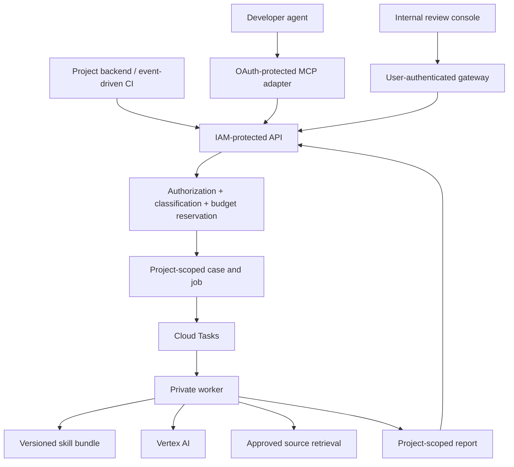

# Cure Legal Review Service — scope and architecture

Date: 2026-10-12. Status: experimental development access release implemented; professional and production gates remain open.
ID: PRD-LEGAL-001 / RFC-LEGAL-001.
Owner: Cure Consulting Group. Model provider: Google Vertex AI (user selected).

## Plan index

- [Scope, architecture, contracts, and operating requirements](README.md)
- [Build backlog, acceptance criteria, and release gates](BUILD-PLAN.md)
- [Cloud placement evidence and future shared services](PORTFOLIO-SERVICES.md)
- [Current implementation and billing status](IMPLEMENTATION-STATUS.md)

Expanded completion scope and portfolio baseline are now maintained with the runtime:
`cure-agent-services/docs/COMPLETION-SCOPE.md` and `docs/PORTFOLIO-BASELINE.md`.
They add NY estates/probate, financial/crypto issue triage, consumer-health privacy, and documented
US state/merchant-country coverage to the original pilot. Broad completion requires per-profile
benchmark gates; the original pilot schedule is not an estimate for all law functions.

## 1. Product outcome

Every authorized Cure project can submit a legal question or a bounded review and receive an evidence-backed report through an API, MCP, or internal review console. Each report identifies the facts used, jurisdiction, applicable date, sources, uncertainty, recommended action, and issues requiring qualified counsel. The service reviews approved context and maintains a project-specific review history.

Example: an Initiated Recruiting developer asks whether a proposed athlete-profile sharing flow raises consent issues. The service receives the proposed flow and a synthetic data sample, asks for missing facts, retrieves relevant authority, and returns findings tied to the flow and sources. It does not inspect athlete records automatically or change the application's consent policy.

The software is a review assistant. Its output is not a legal approval, attorney-client privilege, or permission to ship. A completed run and a human disposition are separate records.

## 2. Evidence and reuse

This repository contains:

- `agents/legal-compliance.md`: QSBS, FERPA, NCAA, trademark, and entity-compliance review; local read tools; 15-turn cap; findings at all severities.
- `agents/contract-reviewer.md`: business risk in contracts, SOWs, MSAs, NDAs, IP, payment, liability, and termination.
- `skills/security/compliance-architect/SKILL.md`: privacy and regulated-data control design.
- `skills/security/qsbs-compliance/SKILL.md` and tax skills: positions and evidence that require CPA or tax-attorney review.
- `skills/business/public-sector-contracting/SKILL.md`: public-sector contract concerns.
- `skills/legal/legal-doc-scaffold/SKILL.md`: explicitly requested drafting, with publishing/signing restricted pending attorney approval.
- `bootstrap/`: manifest-driven installation and managed project instructions.
- `docs/GUARDRAILS.md`: local runtime restrictions and existing regulated-project requirements.

General legal research/doctrine skills appear in the installed skill catalog, but are absent from this checkout. During the first build package, their source was reconciled against the official `v7.13.0` tag, commit `fd5b82cdae0963e97ec0c534c2b08cfe95a652fb`. The runtime exports a pinned development-only bundle from that release; domain validation and distribution-license review remain pending. This checkout is not upgraded implicitly.

Local agent frontmatter, hooks, filesystem tools, and memory behavior do not automatically work in a hosted runtime. Translate them into an explicit server policy, approved tool registry, and skill manifest. Never execute shell preprocessing or install dependencies based on skill text at runtime.

## 3. Users and scope

| User | Need | Entry point |
|---|---|---|
| Developer or project agent | Ask about a proposed feature or diff | MCP / API |
| Product or business owner | Review a flow, contract, or policy | Internal console |
| Release owner | Resolve outstanding legal findings | Review history / export |
| Counsel or CPA | Assess the evidence and record a disposition | Authorized reviewer role |
| Platform owner | Operate access, spend, releases, and incidents | Admin controls / telemetry |

Must ship for the first pilot:

- Questions and text/document reviews with jurisdiction and effective-date inputs.
- Scoped contract and product-compliance profiles; only validated domains enabled.
- Missing-fact follow-ups, source retrieval, claim-to-source mapping, and explicit coverage limitations.
- Asynchronous submissions, status, cancellation, bounded report history, and exports.
- Service-account API access and authenticated developer MCP access.
- Minimal internal console: intake, job status, report, follow-up, disposition, and project administration.
- Tenant isolation, budgets, reproducible version metadata, retention/deletion, evals, and incident runbooks.

Should ship after the first pilot:

- Opt-in GitHub PR review using a project-installed GitHub App and immutable commit references.
- Re-review when a document or governing rule changes, with a visible comparison.
- Additional product profiles, enabled individually after domain evaluation.

Later scope:

- Explicitly requested draft clauses/documents as a separate capability and workflow.
- Approved notifications and scheduled review reminders.
- Licensed legal databases and deeper case-law treatment research.
- Dedicated deployments for projects whose data boundary prohibits central processing.

Excluded from the first release: legal filings, signatures, contract sending, publication, autonomous remediation, direct production database browsing, clinical decisions, tax filing, public end-user legal advice, and unlimited general legal coverage.

## 4. Hosting proposal

Use dedicated projects with provisional IDs `cure-agent-services-dev` and `cure-agent-services-prod`; naming availability is unverified. Add staging before production promotion; dev is never a production data destination. Link the projects to the existing open **Cure Consulting Billing** account. Keep billing exports and cost observation in `cure-finops-ops`.

This is still a Cure Consulting service. A dedicated GCP project provides a separate IAM, quota, data, and deployment boundary; it does not require a different corporate entity. The live project inventory does not show an organization parent for the two relevant existing projects. Do not assume that a billing account is a Google Cloud organization.

Prefer an independent runtime repository, provisionally `Cure-Consulting-Group/cure-agent-services`. This skill repository remains the source of reviewed domain instructions; its plugin postinstall must never provision cloud infrastructure. Export approved skill bundles as pinned build artifacts. First deployment contains only the legal domain. Extract a generic platform package after a second domain establishes what is reusable.

Deployment components:

| Component | Responsibility |
|---|---|
| Cloud Run API | Validate identity, project membership, payload, budget, idempotency, and capability |
| Cloud Run MCP adapter | Expose legal tools; use the same application handlers and authorization |
| Cloud Run worker | Run a bounded Vertex AI review; inaccessible to direct client invocation |
| Cloud Tasks | Durable dispatch and bounded retry to the IAM-protected worker |
| Firestore | Project policy, principals, cases, jobs, findings, decisions, budget reservations |
| Cloud Storage | Approved uploads, normalized documents, reports, source snapshots where licensing permits |
| Vertex AI | Approved Gemini generation and tool use via workload identity |
| Source retrieval adapter | Search and fetch authoritative sources under server policy |
| Cloud Logging / Monitoring | Sanitized traces, service health, failures, per-project cost metrics |
| Internal console | Authenticated submission and review workflow |

Cloud Run supports IAM service invocation using Google-signed ID tokens. Cloud Tasks can invoke an authenticated Cloud Run handler. These are implementation mechanisms, not replacements for application authorization. [Service authentication](https://docs.cloud.google.com/run/docs/authenticating/service-to-service), [task dispatch](https://docs.cloud.google.com/run/docs/triggering/using-tasks).

Production proposal: minimum one instance on intake to reduce cold starts, worker allowed to scale to zero. MCP capacity depends on the selected adapter deployment. A warm instance reduces startup latency; it does not guarantee availability or legal answer latency. [Minimum instances](https://docs.cloud.google.com/run/docs/configuring/min-instances).



Keep the IAM service endpoint separate from the OAuth/user-token adapters so desktop clients are not required to mint GCP ID tokens. The user-facing adapter can be reachable at the network layer, but validates credentials before processing. Its service identity calls the private core; the core validates a verifiable caller context against membership and never trusts a freely supplied identity header. Specify audience, issuer, signing keys, and replay protections during implementation.

## 5. Identity and data boundaries

Each authenticated principal maps to explicit authorized projects and actions. Service principals, users, reviewers, and administrators have different grants:

- Submitter: create/get/cancel permitted project reviews; no access to other projects.
- Reviewer: inspect permitted cases and record dispositions; reviewer qualification is separately recorded.
- Project administrator: membership, context policy, and budget settings within delegated limits.
- Platform operator: operate deployments and metadata; report-content access requires a distinct audited grant.

The caller supplies a project identifier as a selector. The server verifies membership independently on every operation, including upload, export, follow-up, list, and deletion. Worker identity scopes are narrower than operator scopes. Firestore server SDKs bypass client rules: enforce authorization in repository methods and avoid exposing the database directly to clients.

No central broad read grants to product Firestore, clinical stores, financial accounts, or arbitrary repositories. The first integration accepts submitted context and approved registered artifacts. Future repository access is restricted to an installed GitHub App, registered repository, path allowlist, and exact commit.

Pilot accepts public information, synthetic data, approved code snippets, and redacted business documents. A project must authorize transmission to Vertex AI; reject unsupported classifications before provider invocation. PHI, student records, consumer PII prohibited by a project's policy, tax identifiers, and credentials are excluded from the central pilot. Redaction scanners reduce risk but cannot certify that a document is safe.

Existing regulated-runtime requirements in `docs/GUARDRAILS.md` remain a dependency. Cloud operation is a proposed new controlled runtime, requiring explicit policy review before regulated workloads. Until then, regulated projects can send approved architecture descriptions or synthetic examples; data-bearing reviews remain within their authorized boundary.

When central processing is prohibited, deploy the same legal bundle and worker in the product's own GCP project. Share schemas, source updates, and non-sensitive health metrics; do not copy matter content centrally.

## 6. Review workflow

1. Authenticate; resolve project permissions and enabled review profile.
2. Validate jurisdiction, question, desired date, classification, consent, limits, and immutable context references.
3. Reserve project and request budget atomically; create a job with an idempotency key.
4. Validate uploaded documents, reject unsafe formats, scan for secrets, and normalize approved text.
5. Classify the question within enabled coverage; ask for missing facts or explain unsupported scope.
6. Retrieve relevant project artifacts and current public authority through controlled tools.
7. Generate structured findings, tying evidence and sources to each material claim.
8. Validate schema, source existence, claim support, jurisdiction/date fit, and coverage. A second assessment is useful but is not proof of correctness.
9. Return a complete or explicitly partial report, or a needs-information / needs-human-review result.
10. Persist a sanitized execution record; release unused budget; expose human disposition separately.

Execution states: `queued`, `running`, `needs_information`, `completed`, `failed`, `cancelled`.
Report outcomes: `answered`, `findings`, `partial`, `unsupported`, `needs_human_review`.
Human disposition: `unreviewed`, `accepted_for_action`, `changes_requested`, `dismissed_with_reason`.

`completed` means processing finished. A completed report can require counsel review. A missing-information continuation uses the same case but a new versioned job, incorporating the prior questions and supplied answers without silently rewriting the earlier report.

Queue safety: transactional outbox or equivalent recovery handles a database commit followed by a failed enqueue. Worker leases and compare-and-set state transitions prevent concurrent duplicate execution. Cloud Tasks retries are bounded; persistent failures enter a visible failed state with a reconciliation path. Provider calls may still repeat after an ambiguous network failure; record attempt IDs and costs, and never promise exactly-once inference.

## 7. API and MCP contract (API-LEGAL-001)

All contracts are proposals; generate strict JSON Schema and OpenAPI during implementation. Reject unknown object fields and invalid enums. Paginate list operations and cap returned source excerpts.

| HTTP interface | Behavior |
|---|---|
| `POST /v1/legal/reviews` | Submit question or document review; return `202` and `review_id` |
| `GET /v1/legal/reviews/{id}` | Authorized status and report, when available |
| `GET /v1/legal/reviews` | Filtered, paginated project history |
| `POST /v1/legal/reviews/{id}/follow-ups` | Create continuation after additional facts |
| `POST /v1/legal/reviews/{id}/cancel` | Idempotent cancellation request |
| `POST /v1/legal/reviews/{id}/dispositions` | Authorized, attributed human decision |
| `POST /v1/legal/uploads` | Issue a short-lived project-bound upload destination |
| `DELETE /v1/legal/cases/{id}` | Authorized retention-aware deletion request |

Submission fields: `project_id`, `case_id?`, `mode: question|document_review|change_review`, `profile`, `question`, `jurisdictions[]`, `as_of_date`, `context_artifact_ids[]`, `data_classification`, `requested_budget_usd?`. A client budget can lower the server cap, never raise it. `change_review` is enabled only in the PR phase. Idempotency keys are scoped by principal, project, and operation; changed payload with a reused key returns a conflict.

Project context: legal entity, formation jurisdiction, operating regions, audience and age bands, data categories, processors, hosting regions, contracts/policies, and compliance flags. Record source, update date, owner, and confidence for facts; unresolved facts never become settled legal assumptions.

Report fields:

```json
{
  "review_id": "lr_example",
  "status": "completed",
  "outcome": "needs_human_review",
  "summary": "Illustrative report; no legal conclusion represented here.",
  "coverage": {"reviewed": [], "not_reviewed": [], "limitations": []},
  "jurisdictions": ["US"],
  "as_of_date": "2026-10-12",
  "assumptions": [],
  "missing_facts": [],
  "findings": [{
    "id": "finding_example", "domain": "privacy",
    "severity": "high", "confidence": "medium",
    "claim": "Illustrative issue requiring assessment.",
    "evidence_refs": [], "source_refs": [],
    "recommended_action": "Obtain the missing facts and professional review.",
    "human_review_required": true
  }],
  "sources": [],
  "follow_up_questions": [],
  "versions": {"service": "planned", "skill_bundle": "planned", "model": "unselected"},
  "usage": {"input_tokens": 0, "output_tokens": 0, "estimated_cost_usd": 0}
}
```

The example is a shape, not an acceptable final report: substantive legal findings must have evidence/source references or an explicit unsupported/partial outcome. Source records include URL or licensed identifier, title, authority type, jurisdiction, provision/page, publication/effective date when known, retrieval time, relevant excerpt, and content fingerprint. Trace a material legal assertion to both the project facts and supporting authority. Distinguish contractual risk judgments from statements of law.

MCP tools:

| Tool | Side effects and annotations |
|---|---|
| `ask_legal_question` | Creates a review job and incurs compute/model cost; not read-only; idempotent with key |
| `request_legal_review` | Creates a document/change review job; not read-only; idempotent with key |
| `get_legal_review` | Reads authorized status/report; read-only and idempotent |
| `list_legal_reviews` | Reads paginated authorized history; read-only and idempotent |
| `answer_legal_follow_up` | Creates a continuation job and incurs cost; not read-only; idempotent with key |

Long reviews return a handle promptly; avoid holding an MCP connection for the entire review. Use HTTP MCP with the current supported authorization flow and client interoperability checks. Pin a compatible SDK/spec combination after examining actual client support. [MCP authorization](https://modelcontextprotocol.io/specification/latest/basic/authorization).

Errors: `401` invalid identity, `403` unauthorized project/action, `404` inaccessible or missing artifact, `409` idempotency/state conflict, `413` input limit, `422` unsupported classification/profile or invalid facts, `429` quota/budget rejection, `503` provider/service unavailable. MCP tool execution errors use actionable tool results; protocol errors remain protocol errors. Do not leak existence across tenants or raw upstream errors.

## 8. Vertex AI and legal retrieval

Use Vertex AI with workload identity and a least-privilege service identity. No consumer API keys in clients. Select a generally available model available in the approved location after quality, latency, and cost evaluation. Pin an explicit model version where supported and record the resolved model on every attempt; monitor deprecations.

Use a small deterministic router plus one bounded review agent with profile-specific skills. Start without autonomous specialist handoffs. Internal tools: read approved artifacts, search public authority, retrieve approved public sources, and submit a structured report. The model never receives membership-admin, billing-admin, filing, email, arbitrary network, or shell tools.

Source priority: controlling statutes/regulations, courts and agencies, official governing-body rules, then reviewed secondary commentary. Public web search alone cannot establish that case law remains good law or that a jurisdictional search is exhaustive. If treatment verification is required but unavailable, mark the limitation and refer the question for professional research.

Prefer a controlled public-source retrieval adapter. Search queries contain only abstract legal issues; do not include private contract language, client names, patient details, or project records. Fetching enforces public-address resolution, redirect checks, approved domains, timeouts, content-type and size limits, and blocks metadata/private-network endpoints. Parse source and document text as untrusted data.

Vertex AI supports grounding through a custom search API. Validate model compatibility before selecting this integration; direct server-managed retrieval is an alternative. [Custom search grounding](https://docs.cloud.google.com/vertex-ai/generative-ai/docs/grounding/grounding-with-your-search-api).

Do not assume Vertex AI implies zero retention or identical controls across features. Review the selected model, location, abuse monitoring, caching, and grounding configuration. Google Search grounding has separate retention terms, so it is disabled for private-context runs until an approved configuration is documented. [Vertex data retention](https://docs.cloud.google.com/vertex-ai/generative-ai/docs/vertex-ai-zero-data-retention), [feature security controls](https://docs.cloud.google.com/vertex-ai/generative-ai/docs/security-controls).

Skill bundles contain a manifest of source commit, content hashes, review profiles, allowed tools, jurisdictions, author/reviewer, validation date, and license. Updating the desktop plugin does not update a production legal service. Cloud promotion requires its own eval and canary release.

## 9. Storage, memory, and retention

Suggested paths: `projects/{project}/cases/{case}/reviews/{review}`; separate collections for principals, project policy, budget reservations, audit events, and dispositions. Blob paths include environment/project/case and use opaque artifact IDs. No public buckets or long-lived download URLs. Reports and exports inherit project classification and permissions.

Working memory is per run; follow-ups retrieve only their authorized case. No automatic cross-project or global legal memory. Shared public authorities may be cached; private response caches must be partitioned by environment, project, authorization scope, artifact version, date, model, and skill version.

Proposed pilot retention: raw uploads 7 days; normalized context and reports 30 days; sanitized operational metadata 90 days. Audit/disposition retention and backups require an approved records policy before production; raw uploads cannot expire while an active run requires them. Lifecycle and sweeper jobs cover blobs, Firestore data, exports, caches, and abandoned uploads. A deletion request reports active-store completion and the remaining backup/provider-retention window. Legal holds are explicit and audited, with a user-visible refusal reason when they block deletion.

Logs contain IDs, stages, latency, token counts, costs, and sanitized error codes. No prompt bodies, document text, source queries with confidential data, credentials, or unrestricted full trajectories. Evaluation replay uses synthetic fixtures or separately approved redacted cases. Full content tracing is an opt-in, project-scoped feature with its own retention policy.

## 10. Limits, reliability, and spend

Initial configurable ceilings (planning assumptions, validate in pilot):

| Limit | Initial proposal |
|---|---|
| Input | 5 documents, 50 pages total, 10 MB total; text/Markdown and text-based PDF |
| Question length | 8,000 characters |
| Model turns | 10 per job |
| Public-source calls | 12 per job, at most 6 concurrent reads |
| Worker elapsed time | 5 minutes; return partial/failure with explicit reason |
| Model/network retries | At most 2 bounded transient retries per operation, within total caps |
| Repeated identical call | Stop after 3 repetitions |
| Submit quota | 10/minute per principal, 2 active jobs/project during pilot |
| Question/review estimated spend | $1 / $5 server ceilings |
| Pilot project daily spend | $25; total service daily ceiling $100 |

These are ceilings, not predicted prices or guaranteed latency. Reserve the upper bound for the next model/tool call before dispatch; reject when insufficient. Token/output limits, request counts, atomic reservations, concurrency caps, and a kill switch constrain spend. Provider usage arrives imperfectly, so report estimate versus reconciled cost. The alerts-only Cloud Billing budget used for development does not enforce these request caps. Any provider spend-cap feature requires separate eligibility/configuration review and does not replace request-level controls.

Proposed SLOs: 99.5% monthly intake/status availability; p95 accepted submission under 2 seconds excluding upload; p95 bounded question under 60 seconds; p95 bounded document review under 5 minutes; 100% terminal/needs-information visibility after deadline reconciliation. Provider latency can cause partial reports; infrastructure health and legal quality are separate measures.

Use max instances and queue dispatch controls, retry only transient failures, cancel cooperatively before new expensive calls, and reconcile stranded jobs. No automatic provider switch: Vertex AI failure returns a visible error/partial result. Roll back an application or bundle revision without changing the report provenance or breaking stored schema compatibility.

Monthly operating model: `Cloud Run + queue + storage + monitoring + Vertex tokens + source/grounding fees + professional review`. Attribute every review to `product`, `project`, `domain`, `case`, `run`, `model`, and bundle version. Shared-project chargeback is an internal allocation; it is not product-level separation in the provider's billing export. Measure 50 representative runs before approving a monthly operating budget.

## 11. Quality and launch gate

Build 60 synthetic/redacted golden cases: 15 contracts, 15 product/privacy questions, 10 jurisdiction/date/authority cases, 10 missing-fact/unsupported-domain cases, and 10 adversarial/isolation cases. Include recruiting and education scenarios without live student/athlete data. A qualified legal reviewer validates expected analysis for enabled legal domains; a CPA/tax attorney validates tax/QSBS content.

Pilot targets: at least 90% adequate reviews by the domain rubric; zero fabricated citations; at least 95% supported material legal claims in sampled reports; all seeded critical issues identified; all missing-jurisdiction and unavailable-authority cases explicitly qualified; zero cross-project disclosure in deterministic authorization tests. Block launch for any unresolved severe access, citation, or critical-finding failure. A finite dataset cannot prove universal reliability.

Include API/MCP contracts, authorization, uploads, SSRF, injection, retry/idempotency, budget races, deletion, failure reconciliation, model schema failures, and human-disposition integrity. Domain quality is evaluated independently from transport correctness. Model, source, tool, or bundle changes rerun affected cases and the isolation suite before canary promotion.

Pilot baseline records time spent on current manual triage, referral frequency, and reviewer corrections. Success means useful evidence-backed triage with a measurable reduction in reviewer preparation time, not replacing counsel. Proposed utility target: 30% lower preparation time across at least 20 paired pilot reviews, without a critical quality regression.

## 12. Decisions and risks

| Decision | Status / default | Needed by |
|---|---|---|
| Provider | Vertex AI selected by user | Resolved |
| Hosting | Dedicated Cure projects; Cure Consulting Billing | Infrastructure planning |
| Pilot | Recommend redacted Cure contracts, then Initiated Recruiting synthetic feature questions | Sprint 0 |
| Region/model | Select by data policy, availability, and golden-case results | Before integration |
| Source access | Public authority first; licensed case-law access separately budgeted | Coverage design |
| Professional reviewer | Name counsel and CPA/tax reviewer for enabled domains | Before domain validation |
| Retention/classifications | Proposed limits above; project policies may be stricter | Before real uploads |
| Identity provider | Reuse existing internal identity after checking issuer and client support | Sprint 0 |
| Placement governance | Resolve proposed FinOps ADR-0009 and regulated-runtime requirements explicitly | Before deployment |

Main risks: incomplete authority research; stale rules or project facts; skill/catalog drift; prompt injection; central data exposure; privacy leakage into source searches; retry cost amplification; treating findings as approval; and delayed reviewer availability. Address them through scoped coverage, immutable provenance, server permissions, isolated deployments where needed, conservative partial outcomes, bounded work, and professional validation.

Next concrete implementation package: Sprint 0 in [BUILD-PLAN.md](BUILD-PLAN.md), producing a verified skill manifest, draft runtime repository structure, identity/placement decision, and synthetic fixtures before deploying cloud resources.

## Saved handoff — 2026-10-13 UTC

Canonical implementation checkpoint and durable memory are now saved in the separate runtime:
[STATE.md](https://github.com/Cure-Consulting-Group/cure-agent-services/blob/main/STATE.md),
[memory index](https://github.com/Cure-Consulting-Group/cure-agent-services/blob/main/docs/memory/MEMORY.md),
and [next build package](https://github.com/Cure-Consulting-Group/cure-agent-services/blob/main/docs/NEXT-PHASE.md).
The original plan above is historical context; dated runtime validation records determine what is
implemented and which quality, source, records and production gates remain unsatisfied.
